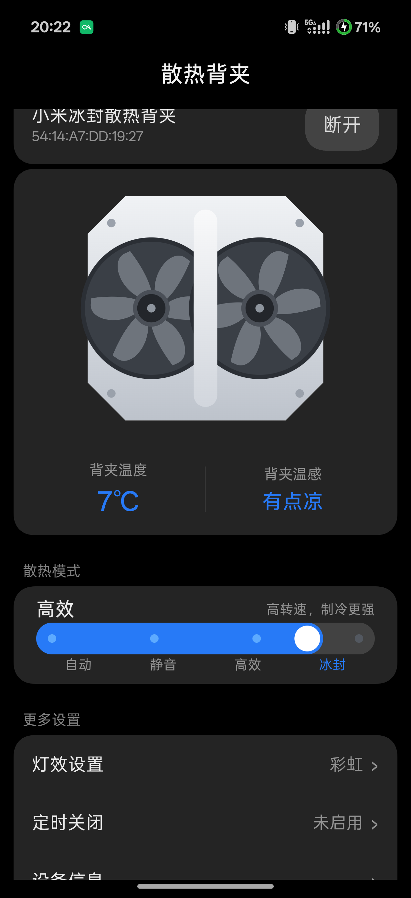
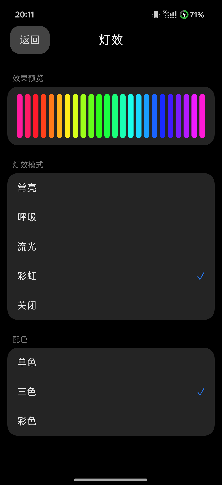
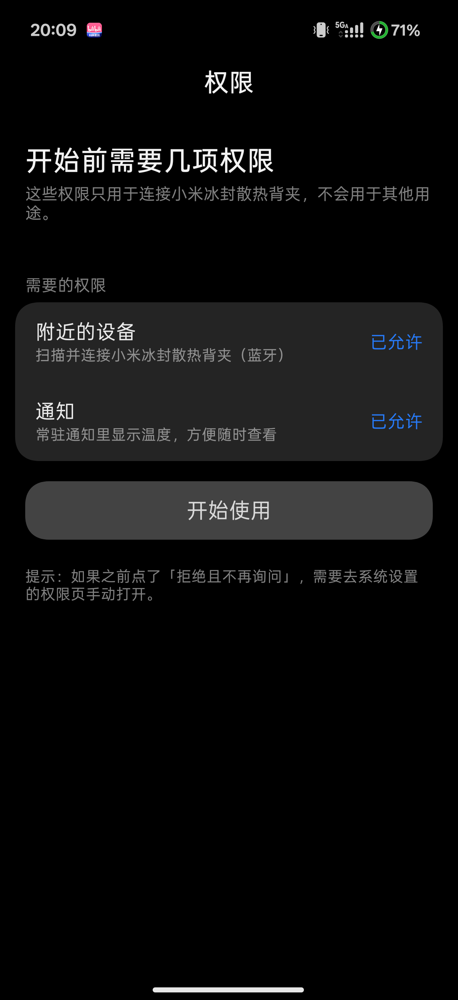

# 背夹控制 · CoolerControl

[](https://github.com/mingzun09/CoolerControl/actions/workflows/build.yml)
[](LICENSE)

小米冰封散热背夹（"小米背夹"）的第三方 Android 控制 App。

在没有小米系统界面的手机（如 一加 15 / OxygenOS）上，原厂只能靠背夹上的物理按键切模式，
既调不了灯效也看不到温度。这个 App 复刻了 HyperOS 里那个专属设置页的全部功能。

> 协议来自对 `com.xiaomi.bluetooth` 的静态逆向 + 真机实测，详见 [docs/protocol.md](docs/protocol.md)。
> 本项目与小米官方无关，仅供个人使用。

| 主页 | 灯效 | 权限 |
|---|---|---|
|  |  |  |

## 功能

- **无需配对**直接连接；已配对 / 上次连过的背夹进 App 自动连上
- **实时温度**：设备每 2–3 秒上报，前台服务在通知栏常驻显示
- **四档散热模式**：自动 / 静音 / 高效 / 冰封，滑块切换，风扇转速与模式联动
- **灯效**：常亮 / 呼吸 / 流光 / 彩虹 / 关闭 × 单色 / 三色 / 彩色，带动画预览
- **定时关闭**：30 分钟 / 1 小时 / 2 小时，倒计时实时走动
- **ColorOS 流体云**：连接后状态栏胶囊显示温度，展开卡片可直接「切换模式」（基于 Android 16 实时更新 API）
- 深浅色跟随系统、断线自动重连、未连接时功能置灰

## 设备示意图

主页的设备图由三层 Z 轴叠加而成：

1. 黑色圆形内腔
2. 灯盘 + 扇叶（一枚，圆心固定在全局中心，半径取整体高度的 40%）
3. 抠空的机身（外壳 + 中缝横梁）压在最上层，自然遮挡风扇中间

风扇带惯性加减速与高速残影，灯效按 12 扇区绘制并叠加发光。

底图 `app/src/main/assets/cooler_body.webp` **不在仓库中**（版权不属于本项目）：

- 缺少该文件时自动退回自绘矢量外壳，功能不受影响
- 想用实拍图，自己放一张同名文件进去即可（正面、比例约 897:676）

## 协议速览

```
GATT 服务 0000af00-…   写 0000af07-…   通知 0000af08-…
帧  FE DC BA | flags | opcode | len(2) | seq | TLV… | EF
TLV [len][type(2)][value]
属性 0x3F 温度(有符号℃)  0x40 模式  0x41 定时秒数  0x42 灯效(模式,配色)
```

| 属性 | 取值 |
|---|---|
| 模式 `0x40` | 0 自动 · 1 静音 · 2 冰封 · 3 高效 |
| 灯效 `0x42[0]` | 0 关闭 · 1 彩虹 · 2 呼吸 · 3 流光 · 4 常亮 |
| 配色 `0x42[1]` | 0 彩色 · 1 单色 · 2 三色 |

## 构建

需要 JDK 21 与 Android SDK（platform 37、build-tools 36.0.0）。

```bash
echo "sdk.dir=/path/to/Android/Sdk" > local.properties
./gradlew :app:assembleDebug
```

| 组件 | 版本 |
|---|---|
| Gradle / AGP | 8.14.8 / 8.13.2 |
| Kotlin / Compose | 2.4.21 / JetBrains Compose 1.10.3 |
| UI 库 | [Miuix](https://github.com/compose-miuix-ui/miuix) 0.9.0 |
| compileSdk / targetSdk / minSdk | 37 / 36 / 29 |

## 工程结构

```
app/src/main/java/com/cooler/control/
├── protocol/  帧编解码、TLV、属性与枚举（纯 Kotlin，有单测）
├── ble/       GATT 客户端、状态流、自动连接、轮询
├── service/   前台服务 + 通知栏温度
├── ui/        主界面 / 灯效 / 定时 / 设备信息 / 权限
│   ├── FanMotor.kt           风扇与灯盘绘制（运动、残影、发光环）
│   ├── CoolerIllustration.kt 三层 Z 轴叠加与开口抠图
│   └── LightEffect.kt        灯效取色（预览与风扇共用）
├── CoolerApp.kt
├── CoolerViewModel.kt
└── MainActivity.kt
```

## 测试

`app/src/test/…/CoolerProtocolTest.kt` 用真机抓到的报文校验编解码：

```bash
./gradlew :app:testDebugUnitTest
```

## 流体云 / 实时更新说明

ColorOS 把 Android 16 的「提升型常驻通知（Live Update）」渲染成流体云。App 已经按规范实现：

- 通知带 `setRequestPromotedOngoing(true)` 与 `setShortCriticalText(温度)`
- 系统开关由用户控制，默认关闭。开启方式：
  - App 内「设备信息 → 权限 → 流体云 / 实时更新」跳转系统设置，或
  - `adb shell cmd appops set com.cooler.control POST_PROMOTED_NOTIFICATIONS allow`

## 已知问题 / 待办

- “高效”映射到取值 3，尚未在所有固件上验证
- 设备改名、固件版本读取、OTA 未实现
- 不同固件版本可能属性表不同，App 会在缺失属性时降级显示

## 许可

[Apache-2.0](LICENSE)。不使用任何小米官方素材，界面元素均为自绘。